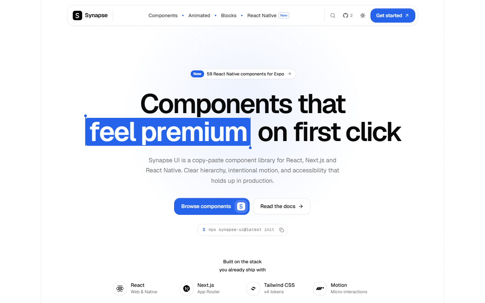
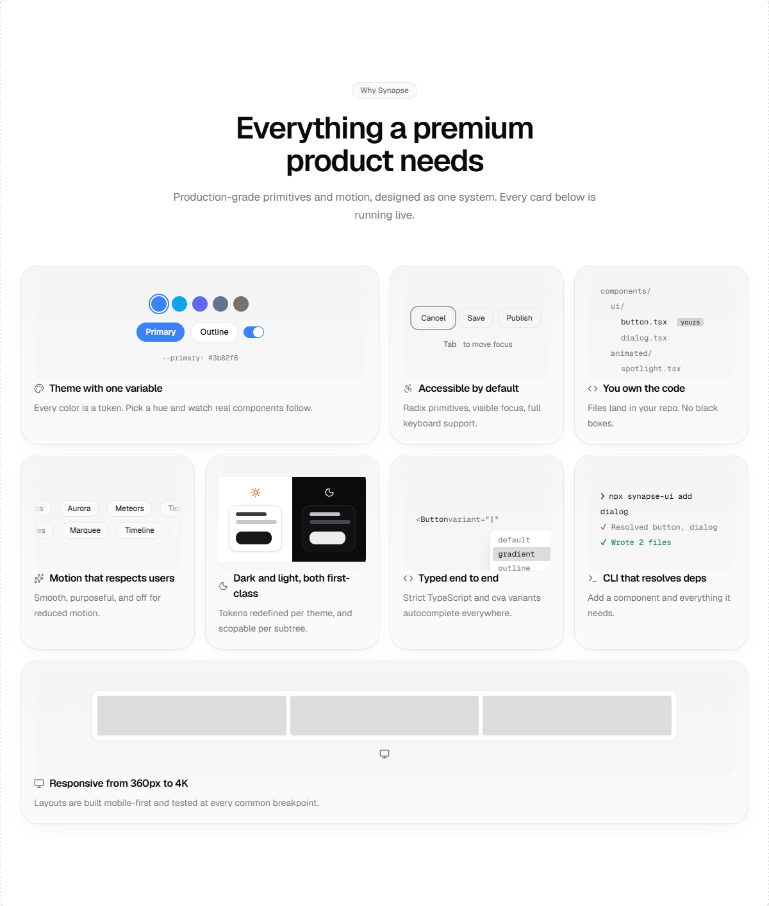
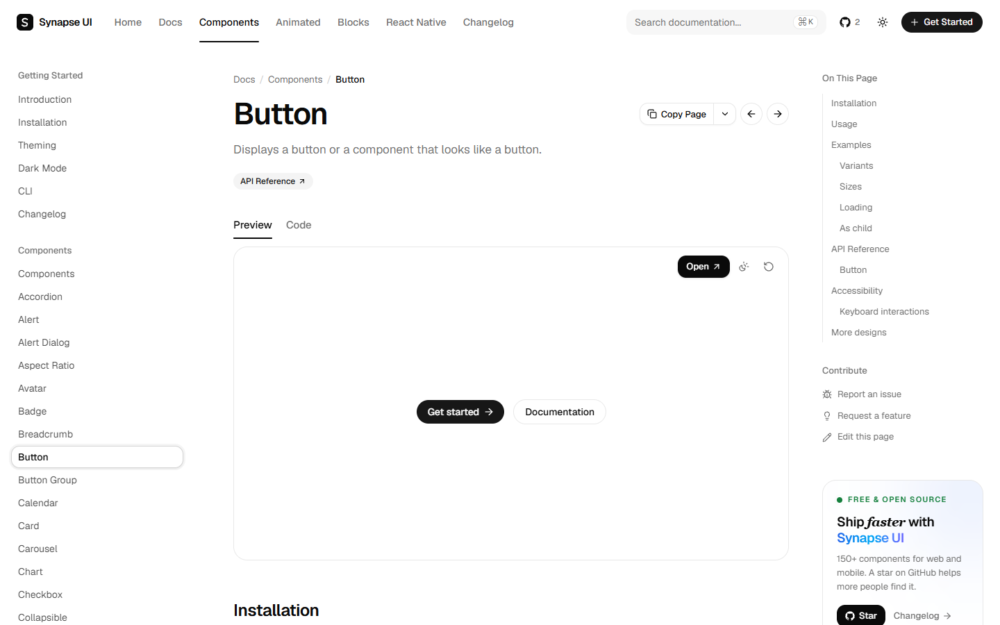
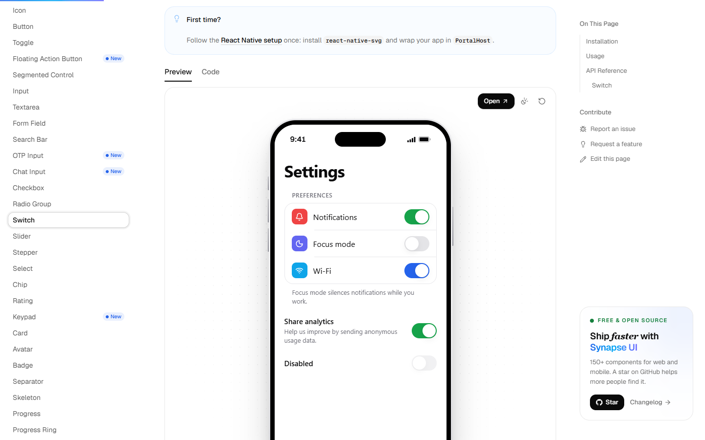
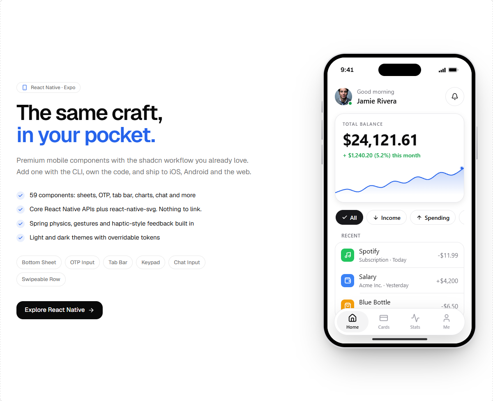
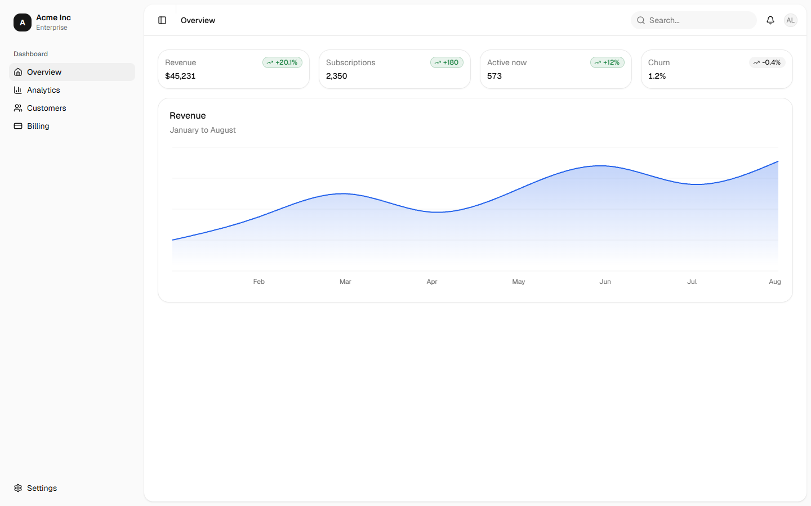
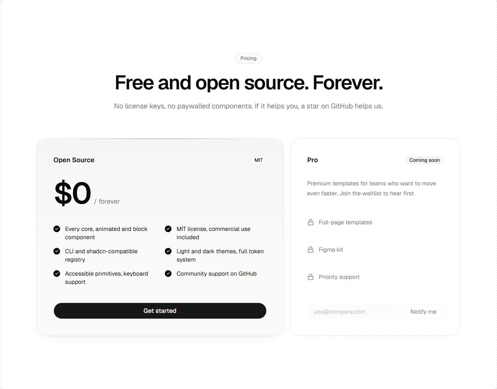
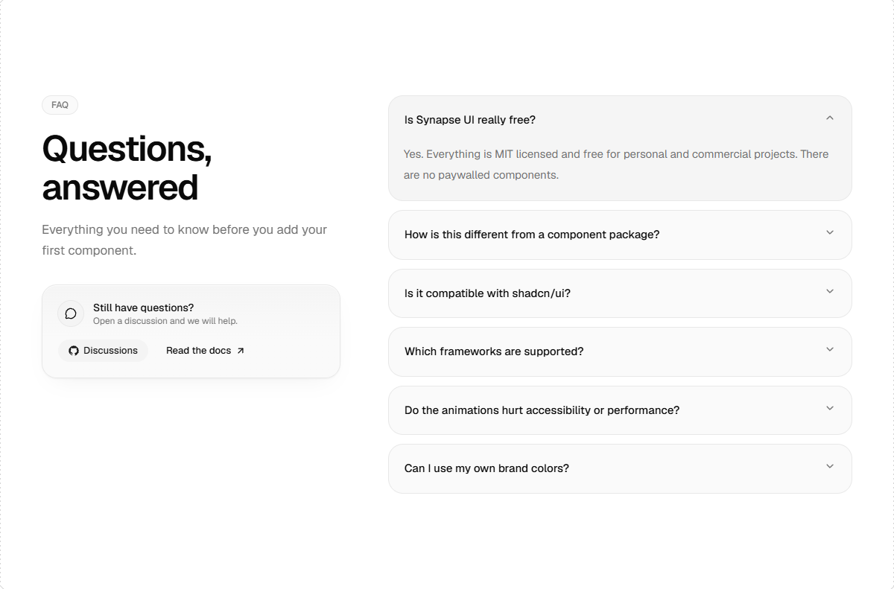

<div align="center">

<a href="https://synapse-ui-dev.vercel.app">
  
</a>

<h1>Synapse UI</h1>

<p><strong>Beautiful, accessible React components and refined motion.<br />Copy them into your project. Own every line.</strong></p>

<p>
  <a href="https://synapse-ui-dev.vercel.app/docs">Documentation</a> ·
  <a href="https://synapse-ui-dev.vercel.app/docs/components">Components</a> ·
  <a href="https://synapse-ui-dev.vercel.app/docs/animated">Animated</a> ·
  <a href="https://synapse-ui-dev.vercel.app/docs/blocks">Blocks</a> ·
  <a href="https://synapse-ui-dev.vercel.app/docs/react-native">React Native</a> ·
  <a href="https://synapse-ui-dev.vercel.app/docs/changelog">Changelog</a>
</p>

<p>
  <a href="https://github.com/therajarshichakraborty/Synapse-UI/stargazers"></a>
  <a href="./LICENSE"></a>
  
  
</p>

<br />



</div>

<br />

## Overview

Synapse UI is a component library for React and Next.js that you **don't install as a dependency**. Each component is a single, readable TypeScript file that the CLI copies into your repository. You change it, theme it and ship it, and no upstream release can ever break your app.

It combines the structure and developer experience of [shadcn/ui](https://ui.shadcn.com) with the cinematic, motion-rich sections popularised by [Aceternity UI](https://ui.aceternity.com), in one calm, monochrome design system that works just as well in light and dark.

- **53 core components.** A complete, shadcn-compatible set from Accordion to Tooltip, built on Radix primitives.
- **31 animated components.** Spotlight, Aurora, Marquee, Number Ticker, Floating Dock, Timeline and more. Every one respects `prefers-reduced-motion`.
- **12 blocks.** Heroes, features, pricing, testimonials, FAQ, auth pages and a full dashboard shell.
- **59 React Native components.** Premium, Expo-ready components for mobile: bottom sheets, OTP input, tab bar, charts, chat and more. Built on core React Native and `react-native-svg`.

## Contents

- [Why Synapse UI](#why-synapse-ui)
- [Preview](#preview)
- [Quick start](#quick-start)
- [Usage](#usage)
- [Theming](#theming)
- [Tech stack](#tech-stack)
- [Component catalog](#component-catalog)
- [Local development](#local-development)
- [Project structure](#project-structure)
- [Adding a component](#adding-a-component)
- [Accessibility and performance](#accessibility-and-performance)
- [Roadmap](#roadmap)
- [Contributing](#contributing)
- [License](#license)

## Why Synapse UI



|                                      |                                                                                                                                         |
| ------------------------------------ | --------------------------------------------------------------------------------------------------------------------------------------- |
| **You own the code**                 | Components land in `components/ui`, `components/animated` and `components/blocks`. No black boxes, no version lock-in.                  |
| **Tokens, not hardcoded colors**     | Every surface reads a semantic CSS variable (`--background`, `--primary`, `--muted-foreground` and so on). Rebrand by editing one file. |
| **Accessible by default**            | Radix UI primitives give correct ARIA, focus management and full keyboard support. Every docs page lists its keyboard interactions.     |
| **Motion with restraint**            | Ease-out curves, 150 to 400 ms in UI, longer only for hero reveals. Everything switches off for users who prefer reduced motion.        |
| **Light and dark, both first-class** | Two complete palettes, plus scoped `.light` / `.dark` subtrees for previews and marketing sections.                                     |
| **Typed end to end**                 | Strict TypeScript, `forwardRef`-compatible props and `cva` variants that autocomplete in your editor.                                   |
| **CLI that resolves dependencies**   | `npx synapse-ui add date-picker` also brings in `popover`, `calendar` and `button`, and installs the npm packages they need.            |

## Preview

All screenshots are taken from the live site in light mode.

<table>
  <tr>
    <td width="50%"></td>
    <td width="50%"></td>
  </tr>
  <tr>
    <td align="center"><sub><b>Docs.</b> Preview / Code tabs, Copy Page for LLMs, install steps and props tables.</sub></td>
    <td align="center"><sub><b>React Native.</b> 59 Expo components, previewed live in a phone frame.</sub></td>
  </tr>
  <tr>
    <td width="50%"></td>
    <td width="50%"></td>
  </tr>
  <tr>
    <td align="center"><sub><b>Mobile.</b> The same craft, running live with react-native-web.</sub></td>
    <td align="center"><sub><b>Dashboard Shell block.</b> Sidebar, stat cards and a themed chart.</sub></td>
  </tr>
  <tr>
    <td width="50%"></td>
    <td width="50%"></td>
  </tr>
  <tr>
    <td align="center"><sub><b>Pricing.</b> Free and open source, forever.</sub></td>
    <td align="center"><sub><b>FAQ.</b> Built with the Accordion component.</sub></td>
  </tr>
</table>

## Quick start

### 1. Initialize

Installs the base dependencies, adds the `cn()` helper and writes the design tokens into your global stylesheet.

```bash
npx synapse-ui@latest init
```

> [!NOTE]
> The `synapse-ui` CLI lives in [`packages/cli`](./packages/cli) and is not on npm yet. Until it is published, use the shadcn CLI command in the tip below, which works today.

### 2. Add components

```bash
npx synapse-ui@latest add button card dialog
npx synapse-ui@latest add spotlight marquee number-ticker
npx synapse-ui@latest add dashboard-shell
```

> [!TIP]
> Prefer the shadcn CLI? Every item is published in the shadcn registry format:
>
> ```bash
> npx shadcn@latest add https://synapse-ui-dev.vercel.app/r/button.json
> ```
>
> Or register Synapse as a namespace in `components.json`:
>
> ```json
> { "registries": { "@synapse": "https://synapse-ui-dev.vercel.app/r/{name}.json" } }
> ```

### Requirements

|              | Version                   |
| ------------ | ------------------------- |
| React        | 19 or later               |
| Tailwind CSS | v4                        |
| TypeScript   | 5 (recommended)           |
| Node.js      | 18 or later (for the CLI) |

## Usage

```tsx
import { Button } from "@/components/ui/button";
import { Card, CardContent, CardHeader, CardTitle } from "@/components/ui/card";
import { NumberTicker } from "@/components/animated/number-ticker";

export default function Revenue() {
  return (
    <Card className="w-80">
      <CardHeader>
        <CardTitle>Monthly revenue</CardTitle>
      </CardHeader>
      <CardContent className="flex items-end justify-between">
        <NumberTicker value={48295} prefix="$" className="text-3xl font-semibold" />
        <Button size="sm" variant="secondary">
          Details
        </Button>
      </CardContent>
    </Card>
  );
}
```

## Theming

Every color is a CSS variable, defined once for light and once for dark. Components only ever use semantic utilities such as `bg-primary`, `text-muted-foreground` and `border-border`.

```css
:root {
  --radius: 0.75rem;
  --background: #ffffff;
  --foreground: #0a0a0a;
  --primary: #171717;
  --primary-foreground: #fafafa;
  --muted-foreground: #737373;
  --border: #e8e8e8;
  --brand: #2563eb; /* the single accent, used sparingly */
}

.dark {
  --background: #0b0b0c;
  --foreground: #ededef;
  --primary: #ededef;
  --primary-foreground: #0b0b0c;
  --muted-foreground: #9b9ba1;
  --border: rgb(255 255 255 / 0.075);
  --brand: #3b82f6;
}
```

| Token group                                   | Purpose                               |
| --------------------------------------------- | ------------------------------------- |
| `background`, `foreground`                    | Page and default text                 |
| `surface-1` to `surface-3`, `card`, `popover` | Elevation levels                      |
| `primary`, `secondary`, `accent`, `muted`     | Actions, quiet surfaces, hover states |
| `destructive`, `success`, `warning`           | Status                                |
| `border`, `border-strong`, `input`, `ring`    | Hairlines, controls and focus         |
| `brand`                                       | The blue accent                       |
| `chart-1` to `chart-5`                        | Chart series                          |

Effect utilities ship with the tokens: `surface-premium`, `glass`, `border-beam`, `text-gradient`, `mask-edge-fade-x` and more. See the [theming guide](https://synapse-ui-dev.vercel.app/docs/theming) and [dark mode guide](https://synapse-ui-dev.vercel.app/docs/dark-mode).

## Tech stack

<p>
  
</p>

| Layer           | Technology                                                                                                                                                                                                                                         |
| --------------- | -------------------------------------------------------------------------------------------------------------------------------------------------------------------------------------------------------------------------------------------------- |
| Framework       | [Next.js 16](https://nextjs.org) (App Router, React Server Components, static generation)                                                                                                                                                          |
| UI runtime      | [React 19](https://react.dev), [TypeScript](https://www.typescriptlang.org) (strict)                                                                                                                                                               |
| Styling         | [Tailwind CSS v4](https://tailwindcss.com) with CSS-variable design tokens, [class-variance-authority](https://cva.style), [tailwind-merge](https://github.com/dcastil/tailwind-merge)                                                             |
| Primitives      | [Radix UI](https://www.radix-ui.com), [Base UI](https://base-ui.com) (Combobox), [cmdk](https://cmdk.paco.me), [Vaul](https://vaul.emilkowal.ski)                                                                                                  |
| Motion          | [Motion](https://motion.dev) (Framer Motion)                                                                                                                                                                                                       |
| Data and forms  | [TanStack Table](https://tanstack.com/table), [React Hook Form](https://react-hook-form.com), [Zod](https://zod.dev), [Recharts](https://recharts.org), [React DayPicker](https://daypicker.dev), [Embla Carousel](https://www.embla-carousel.com) |
| Docs            | [Fumadocs](https://fumadocs.dev) (MDX and search), [Shiki](https://shiki.style) with GitHub light and dark themes                                                                                                                                  |
| Icons and fonts | [Lucide](https://lucide.dev), [Geist and Geist Mono](https://vercel.com/font)                                                                                                                                                                      |
| Tooling         | [Bun](https://bun.sh), ESLint, Prettier                                                                                                                                                                                                            |

<p>
  
  
  
  
  
  
  
  
</p>

## Component catalog

<details open>
<summary><b>Core components</b> (53)</summary>
<br />

|                                                                                |                                                                                |                                                                                  |                                                                                      |
| ------------------------------------------------------------------------------ | ------------------------------------------------------------------------------ | -------------------------------------------------------------------------------- | ------------------------------------------------------------------------------------ |
| [Accordion](https://synapse-ui-dev.vercel.app/docs/components/accordion)       | [Alert](https://synapse-ui-dev.vercel.app/docs/components/alert)               | [Alert Dialog](https://synapse-ui-dev.vercel.app/docs/components/alert-dialog)   | [Aspect Ratio](https://synapse-ui-dev.vercel.app/docs/components/aspect-ratio)       |
| [Avatar](https://synapse-ui-dev.vercel.app/docs/components/avatar)             | [Badge](https://synapse-ui-dev.vercel.app/docs/components/badge)               | [Breadcrumb](https://synapse-ui-dev.vercel.app/docs/components/breadcrumb)       | [Button](https://synapse-ui-dev.vercel.app/docs/components/button)                   |
| [Button Group](https://synapse-ui-dev.vercel.app/docs/components/button-group) | [Calendar](https://synapse-ui-dev.vercel.app/docs/components/calendar)         | [Card](https://synapse-ui-dev.vercel.app/docs/components/card)                   | [Carousel](https://synapse-ui-dev.vercel.app/docs/components/carousel)               |
| [Chart](https://synapse-ui-dev.vercel.app/docs/components/chart)               | [Checkbox](https://synapse-ui-dev.vercel.app/docs/components/checkbox)         | [Collapsible](https://synapse-ui-dev.vercel.app/docs/components/collapsible)     | [Combobox](https://synapse-ui-dev.vercel.app/docs/components/combobox)               |
| [Command](https://synapse-ui-dev.vercel.app/docs/components/command)           | [Context Menu](https://synapse-ui-dev.vercel.app/docs/components/context-menu) | [Data Table](https://synapse-ui-dev.vercel.app/docs/components/data-table)       | [Date Picker](https://synapse-ui-dev.vercel.app/docs/components/date-picker)         |
| [Dialog](https://synapse-ui-dev.vercel.app/docs/components/dialog)             | [Drawer](https://synapse-ui-dev.vercel.app/docs/components/drawer)             | [Dropdown Menu](https://synapse-ui-dev.vercel.app/docs/components/dropdown-menu) | [Empty State](https://synapse-ui-dev.vercel.app/docs/components/empty-state)         |
| [Form](https://synapse-ui-dev.vercel.app/docs/components/form)                 | [Hover Card](https://synapse-ui-dev.vercel.app/docs/components/hover-card)     | [Input](https://synapse-ui-dev.vercel.app/docs/components/input)                 | [Input OTP](https://synapse-ui-dev.vercel.app/docs/components/input-otp)             |
| [Kbd](https://synapse-ui-dev.vercel.app/docs/components/kbd)                   | [Label](https://synapse-ui-dev.vercel.app/docs/components/label)               | [Menubar](https://synapse-ui-dev.vercel.app/docs/components/menubar)             | [Navigation Menu](https://synapse-ui-dev.vercel.app/docs/components/navigation-menu) |
| [Pagination](https://synapse-ui-dev.vercel.app/docs/components/pagination)     | [Popover](https://synapse-ui-dev.vercel.app/docs/components/popover)           | [Progress](https://synapse-ui-dev.vercel.app/docs/components/progress)           | [Radio Group](https://synapse-ui-dev.vercel.app/docs/components/radio-group)         |
| [Resizable](https://synapse-ui-dev.vercel.app/docs/components/resizable)       | [Scroll Area](https://synapse-ui-dev.vercel.app/docs/components/scroll-area)   | [Select](https://synapse-ui-dev.vercel.app/docs/components/select)               | [Separator](https://synapse-ui-dev.vercel.app/docs/components/separator)             |
| [Sheet](https://synapse-ui-dev.vercel.app/docs/components/sheet)               | [Sidebar](https://synapse-ui-dev.vercel.app/docs/components/sidebar)           | [Skeleton](https://synapse-ui-dev.vercel.app/docs/components/skeleton)           | [Slider](https://synapse-ui-dev.vercel.app/docs/components/slider)                   |
| [Sonner](https://synapse-ui-dev.vercel.app/docs/components/sonner)             | [Spinner](https://synapse-ui-dev.vercel.app/docs/components/spinner)           | [Switch](https://synapse-ui-dev.vercel.app/docs/components/switch)               | [Table](https://synapse-ui-dev.vercel.app/docs/components/table)                     |
| [Tabs](https://synapse-ui-dev.vercel.app/docs/components/tabs)                 | [Textarea](https://synapse-ui-dev.vercel.app/docs/components/textarea)         | [Toggle](https://synapse-ui-dev.vercel.app/docs/components/toggle)               | [Toggle Group](https://synapse-ui-dev.vercel.app/docs/components/toggle-group)       |
| [Tooltip](https://synapse-ui-dev.vercel.app/docs/components/tooltip)           |                                                                                |                                                                                  |                                                                                      |

</details>

<details>
<summary><b>Animated components</b> (31)</summary>
<br />

|                                                                                    |                                                                                              |                                                                                             |                                                                                                |
| ---------------------------------------------------------------------------------- | -------------------------------------------------------------------------------------------- | ------------------------------------------------------------------------------------------- | ---------------------------------------------------------------------------------------------- |
| [Spotlight](https://synapse-ui-dev.vercel.app/docs/animated/spotlight)             | [Background Beams](https://synapse-ui-dev.vercel.app/docs/animated/background-beams)         | [Grid and Dot Backgrounds](https://synapse-ui-dev.vercel.app/docs/animated/grid-background) | [Aurora Background](https://synapse-ui-dev.vercel.app/docs/animated/aurora-background)         |
| [Meteors](https://synapse-ui-dev.vercel.app/docs/animated/meteors)                 | [Sparkles](https://synapse-ui-dev.vercel.app/docs/animated/sparkles)                         | [Glowing Border Card](https://synapse-ui-dev.vercel.app/docs/animated/glowing-card)         | [Moving Border Button](https://synapse-ui-dev.vercel.app/docs/animated/moving-border-button)   |
| [3D Tilt Card](https://synapse-ui-dev.vercel.app/docs/animated/tilt-card)          | [Card Spotlight](https://synapse-ui-dev.vercel.app/docs/animated/card-spotlight)             | [Bento Grid](https://synapse-ui-dev.vercel.app/docs/animated/bento-grid)                    | [Infinite Moving Cards](https://synapse-ui-dev.vercel.app/docs/animated/infinite-moving-cards) |
| [Marquee](https://synapse-ui-dev.vercel.app/docs/animated/marquee)                 | [Text Generate Effect](https://synapse-ui-dev.vercel.app/docs/animated/text-generate-effect) | [Typewriter](https://synapse-ui-dev.vercel.app/docs/animated/typewriter)                    | [Flip Words](https://synapse-ui-dev.vercel.app/docs/animated/flip-words)                       |
| [Gradient Text](https://synapse-ui-dev.vercel.app/docs/animated/gradient-text)     | [Number Ticker](https://synapse-ui-dev.vercel.app/docs/animated/number-ticker)               | [Animated Tabs](https://synapse-ui-dev.vercel.app/docs/animated/animated-tabs)              | [Floating Dock](https://synapse-ui-dev.vercel.app/docs/animated/floating-dock)                 |
| [Floating Navbar](https://synapse-ui-dev.vercel.app/docs/animated/floating-navbar) | [Timeline](https://synapse-ui-dev.vercel.app/docs/animated/timeline)                         | [Tracing Beam](https://synapse-ui-dev.vercel.app/docs/animated/tracing-beam)                | [Lamp Effect](https://synapse-ui-dev.vercel.app/docs/animated/lamp-effect)                     |
| [Shimmer Button](https://synapse-ui-dev.vercel.app/docs/animated/shimmer-button)   | [Animated Tooltip](https://synapse-ui-dev.vercel.app/docs/animated/animated-tooltip)         | [Expandable Card](https://synapse-ui-dev.vercel.app/docs/animated/expandable-card)          | [Parallax Scroll](https://synapse-ui-dev.vercel.app/docs/animated/parallax-scroll)             |
| [Terminal](https://synapse-ui-dev.vercel.app/docs/animated/terminal)               | [Code Block](https://synapse-ui-dev.vercel.app/docs/animated/code-block)                     | [Dotted World Map](https://synapse-ui-dev.vercel.app/docs/animated/dotted-world-map)        |                                                                                                |

</details>

<details>
<summary><b>Blocks</b> (12)</summary>
<br />

|                                                                                 |                                                                              |                                                                                  |
| ------------------------------------------------------------------------------- | ---------------------------------------------------------------------------- | -------------------------------------------------------------------------------- |
| [Hero: Spotlight](https://synapse-ui-dev.vercel.app/docs/blocks/hero-spotlight) | [Hero: Split](https://synapse-ui-dev.vercel.app/docs/blocks/hero-split)      | [Hero: Product](https://synapse-ui-dev.vercel.app/docs/blocks/hero-product)      |
| [Feature Section](https://synapse-ui-dev.vercel.app/docs/blocks/feature-grid)   | [Pricing Table](https://synapse-ui-dev.vercel.app/docs/blocks/pricing-table) | [Testimonials](https://synapse-ui-dev.vercel.app/docs/blocks/testimonial-wall)   |
| [FAQ](https://synapse-ui-dev.vercel.app/docs/blocks/faq-section)                | [Call to Action](https://synapse-ui-dev.vercel.app/docs/blocks/cta-panel)    | [Footer](https://synapse-ui-dev.vercel.app/docs/blocks/site-footer)              |
| [Login Page](https://synapse-ui-dev.vercel.app/docs/blocks/login-page)          | [Signup Page](https://synapse-ui-dev.vercel.app/docs/blocks/signup-page)     | [Dashboard Shell](https://synapse-ui-dev.vercel.app/docs/blocks/dashboard-shell) |

</details>

<details>
<summary><b>React Native components</b> (59)</summary>
<br />

For React Native and Expo. Install with `npx synapse-ui@latest add native-<name>`, then follow the [setup guide](https://synapse-ui-dev.vercel.app/docs/react-native).

- **Foundations:** Text, Icon
- **Actions:** Button, Toggle, Floating Action Button, Segmented Control
- **Forms:** Input, Textarea, Form Field, Search Bar, OTP Input, Chat Input, Checkbox, Radio Group, Switch, Slider, Stepper, Select, Chip, Rating, Keypad
- **Display:** Card, Avatar, Badge, Separator, Skeleton, Progress, Progress Ring, Spinner, Alert, Banner, Empty State, List, Accordion, Tabs, Stat Card, Timeline, Steps, Carousel, Page Indicator, Media Card, Plan Card, Chat Bubble, Typing Indicator, Number Ticker, Calendar Strip, Bar Chart, Sparkline
- **Overlays:** Dialog, Alert Dialog, Bottom Sheet, Action Sheet, Dropdown Menu, Tooltip, Drawer, Toast
- **Navigation:** Header, Tab Bar, Swipeable Row

</details>

Every component page follows the same structure: live **preview and code**, **installation** (CLI or manual), **usage**, **examples**, **API reference** and **accessibility** notes with keyboard interactions.

## Local development

```bash
git clone https://github.com/therajarshichakraborty/Synapse-UI.git
cd Synapse-UI
bun install
bun dev
```

Open [http://localhost:3000](http://localhost:3000). Append `?theme=light` or `?theme=dark` to any URL to pin the theme.

| Script                   | What it does                                                          |
| ------------------------ | --------------------------------------------------------------------- |
| `bun dev`                | Start the dev server. Rebuilds the registry and example index first.  |
| `bun run build`          | Production build. Statically generates every docs page and example.   |
| `bun start`              | Serve the production build.                                           |
| `bun run lint`           | ESLint across the project.                                            |
| `bun run typecheck`      | `tsc --noEmit` in strict mode.                                        |
| `bun run format`         | Prettier.                                                             |
| `bun run docs:generate`  | Regenerate component MDX pages from `scripts/docs-meta`.              |
| `bun run registry:build` | Rebuild `public/r/*.json`, the example index and `public/tokens.css`. |

## Project structure

```text
.
├── packages/cli/              # The `synapse-ui` CLI (init, add, list)
├── public/r/                  # Generated registry (shadcn format), one JSON per item
├── scripts/
│   ├── build-registry.mjs     # Builds public/r (shadcn registry JSON)
│   ├── generate-native-icons.mjs  # Builds the React Native icon set from Lucide
│   ├── build-docs-index.mjs   # Builds the lazy example map and tokens.css
│   ├── generate-docs.ts       # Generates component docs pages
│   └── docs-meta/             # Usage, examples, props and a11y per component
└── src/
    ├── app/                   # Next.js routes: landing, /docs, /view/[name] previews
    ├── components/
    │   ├── ui/                # Core components
    │   ├── animated/          # Animated components
    │   ├── blocks/            # Page sections
    │   ├── native/            # React Native / Expo components
    │   ├── docs/              # Preview, install, code block, props table, phone frame
    │   └── site/              # Site chrome and landing sections
    ├── content/docs/          # MDX documentation
    ├── registry/
    │   ├── registry.ts        # Metadata for every documented item
    │   └── examples/          # Live examples used by the docs
    └── lib/                   # Utilities, Shiki highlighter, docs navigation
unused/                        # Retired code (the old collections), kept for reference
```

React Native examples render live in the docs through `react-native-web` (aliased in `next.config.mjs`). Any example named `native-*` is shown inside a phone frame.

## Adding a component

1. **Write the component** in `src/components/ui`, `src/components/animated` or `src/components/blocks`. Use semantic tokens only, `cva` for variants and `cn()` for class merging.
2. **Register it** in `src/registry/registry.ts` with a name, title, description and category.
3. **Add examples** to `src/registry/examples/<name>-demo.tsx` (and any `<name>-<variant>.tsx`).
4. **Describe it** in `scripts/docs-meta/*.ts`: usage, examples, props and keyboard interactions.
5. **Generate** the docs and registry:

   ```bash
   bun run docs:generate
   bun run registry:build
   ```

The new page appears in the sidebar, the ⌘K palette and the CLI automatically.

## Accessibility and performance

- Built on Radix primitives: correct roles, labelling, focus trapping and roving focus.
- Visible focus rings on every interactive element, using the `ring` token.
- `prefers-reduced-motion` disables CSS animations globally, and Motion runs with `reducedMotion="user"`.
- Docs pages and examples are statically generated. Code is highlighted at build time, so no highlighter ships to the browser for docs.
- Every docs page is also served as plain Markdown at `/md/<page>` (e.g. `/md/components/button`), and **Copy Page** puts it on your clipboard for LLMs.
- Keyboard: `⌘K` / `Ctrl+K` to search, `[` and `]` for the previous and next page, `Esc` closes native overlays on the web.
- Examples load lazily, so a docs page only downloads the demos it shows.

## Roadmap

- [x] Dark-first token system with a complete light theme
- [x] 53 core, 31 animated and 12 block components
- [x] 59 React Native components for Expo
- [x] CLI and shadcn-compatible registry
- [ ] Publish the `synapse-ui` CLI to npm
- [ ] Figma kit
- [ ] Full-page templates

## Contributing

Contributions are welcome. Read the [contribution notes](#adding-a-component) above, then:

1. Fork the repository and create a branch: `git checkout -b feat/my-component`
2. Make your change and run `bun run lint && bun run typecheck && bun run build`
3. Open a pull request with screenshots in light and dark mode

Found a bug or have an idea? [Open an issue](https://github.com/therajarshichakraborty/Synapse-UI/issues) or start a [discussion](https://github.com/therajarshichakraborty/Synapse-UI/discussions).

## License

Released under the [MIT License](./LICENSE). Free for personal and commercial use.

<br />

<div align="center">
  <sub>Built by <a href="https://github.com/therajarshichakraborty">Rajarshi Chakraborty</a>. If Synapse UI helps you, consider giving it a ⭐</sub>
</div>
